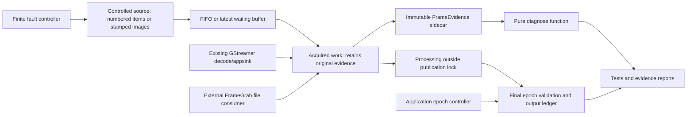

# Codebase guide

Paths below refer to actual first-party files. Start with the small pure modules;
media modules are optional experiment harnesses, not production capture APIs.
The distribution has no mandatory runtime dependencies. Python 3.11+ is required.

## Structure and boundaries

The diagram describes tested conceptual paths, not a generic runtime assembled
from all these modules. The simulator, threaded example, native experiment and
external audit each have explicit observation boundaries. The diagnostic does
not publish; a publication policy must be chosen by the application.

| Directory / file | Role |
| --- | --- |
| src/video_freshness_lab | Typed core and explicitly named optional experiments |
| tests | Default Python-only pytest suite; no GI/NumPy/OpenCV required |
| integration | Optional native/image/RTSP suites, reliability runner and independent audit |
| docs/architecture | Contracts, source lineage, synchronization and transport design |
| docs/experiments | Actual observations and sanitized JSON summaries |
| docs/audits | Requirement matrices, independent audit and decisions |
| .github/workflows/ci.yml | Ubuntu Python 3.11/3.12, read-only CI only |
| pyproject.toml | src packaging, dev pins, optional images extra and pytest discovery |

The original PRDs are local owner inputs. Neither appears in Git history. The
LICENSE file grants MIT terms for the original code, tests and documentation.

## Numbered source, clock and buffers

[model.py](../../src/video_freshness_lab/model.py) defines frozen Frame metadata
with session_id, sequence and produced_at_ms, plus Control. frame_id is derived
from the original session/sequence. Validation rejects invalid integer values;
a consumer never stamps a queued frame with its own new production identity.

[clock.py](../../src/video_freshness_lab/clock.py) implements VirtualClock using
a heap ordered by timestamp, priority and insertion serial. schedule accepts an
explicit time and callback; run_until advances to a boundary and run drains finite
work. It rejects scheduling in the past and nested execution. No OS sleep is used.

[buffers.py](../../src/video_freshness_lab/buffers.py) contains FIFO, LatestFrame
and frozen Admission. push returns admission/drop information; pop transfers the
waiting Frame; clear reports removed items. FIFO uses a deque and optional
capacity with drop_newest/drop_oldest overflow. LatestFrame replaces its one
waiting item. These are single-threaded simulator policies and do not own active
processing. Their thread-safe counterpart is a separate learning implementation.

[simulation.py](../../src/video_freshness_lab/simulation.py) defines validated
Config, Event, Drop, Processing, Metrics and Result. Simulator schedules control,
production, processing completion and no-progress observations on VirtualClock.
Result.to_dict produces explicit event and metric data. Processing separates
start age, completion age, sequence lag and final session validity. A source
horizon ends production; pending finite work may finish afterward.

[experiments.py](../../src/video_freshness_lab/experiments.py) supplies balanced,
overload, slowdown-fifo and slowdown-latest. [recovery_experiments.py](../../src/video_freshness_lab/recovery_experiments.py)
supplies nine named fault presets. [__main__.py](../../src/video_freshness_lab/__main__.py)
selects suites/scenarios and validated overrides; --json emits full evidence.
Virtual production time belongs to this controlled model, not to a physical camera.

## Threaded handoff and output admission

[threaded_mailbox.py](../../src/video_freshness_lab/threaded_mailbox.py) defines
LatestFrameMailbox, MailboxState and MailboxClosed. One Condition protects pending
item, last accepted identity, counters and closed state. submit replaces the
waiting item immediately; get waits in a predicate loop and transfers the original
Frame. Accepted (session_id, sequence) pairs must increase. close is permanent and
idempotent: one pending item drains, then get raises MailboxClosed. A timeout is
an observation guard, not evidence that a frame is fresh. snapshot copies state;
wait_until_waiting gives tests an explicit synchronization boundary.

[threaded_demo.py](../../src/video_freshness_lab/threaded_demo.py) supplies DemoConfig,
ThreadedDemo and run_demo. Normal, slow and idle modes coordinate finite producer
and consumer workers. start/stop/join/shutdown own worker lifetime. WorkerFailed
and ShutdownTimeout report failures rather than silently retrying. Callbacks must
cooperate; Python threads cannot safely be killed to cancel arbitrary native work.

[threaded_sessions.py](../../src/video_freshness_lab/threaded_sessions.py) defines
Result, Completion, BoundaryEvent, SessionState and SessionPipeline. produce stamps
under the epoch lock; acquire blocks without retaining that lock; processing runs
outside it. transition retires the epoch and resets its sequence. complete checks
the original active frame exactly once and appends the delivery decision under
the same lock as epoch changes. This append is the in-memory publication boundary.
fail_processing accounts for work without publishing. close stops input while
shutdown also suppresses output. consume drains cooperatively and records final
outcomes; snapshot separates acquired, processed, failed, rejected and published.
A network callback after this ledger would require its own transactional design.

## Evidence and diagnostics

[evidence.py](../../src/video_freshness_lab/evidence.py) defines frozen Timestamp,
FrameEvidence and Diagnostic. Timestamp carries ticks, exact Fraction time base,
domain, provenance and trust. FrameEvidence distinguishes source-order sequences
from local-delivery ordinals, local arrival, decoder PTS and supported capture
stamps. Immutable decoder metadata is descriptive, not an implicit trust signal.

The pure diagnose function accepts evidence, expected source/epoch, explicit now,
clock domain, age reference/budget and optional predecessor/PTS-gap policy. It
returns independent session and age statuses plus issue codes. Unknown clocks,
missing capture meaning and absent identity remain UNKNOWN. See the [contract](../architecture/frame-evidence-contract.md)
for exact comparability rules. It neither infers a source head nor decides output
admission. Repeated identity needs known source-order provenance; equal image
content by itself is ambiguous.

## Synthetic image lineage

[stamped_images.py](../../src/video_freshness_lab/stamped_images.py) keeps its
pure marker schema importable without media packages; image operations require
the optional environment. Marker encodes source/epoch/sequence and
CRC; generate draws it before admission on a 96x160x3 BGR array. immutable_pixels
backs a read-only view with immutable bytes. StampedImage binds pixels to frozen
evidence. read_marker validates the selected pixel encoding; transform performs
BGR→gray→BGR and PNG roundtrip; verify compares decoded marker with the original
sidecar. No timestamp is recovered from a consumer delivery counter.

ImageSimulator reuses Simulator rather than adding a second queue framework.
It creates images at production and verifies identity at relevant queue/work
boundaries. run_images returns measured model/lineage data. repeated_content
contrasts separate decoded buffers carrying the same stamp, a static region with
advancing stamps and no-data behavior. workloads and main provide finite repeats.
Image processing duration here is a virtual workload assumption, not measured CPU
inference latency. FFV1/file audit verification is a separate path below.

## GStreamer, RTSP and finite transport faults

[gstreamer_contract.py](../../src/video_freshness_lab/gstreamer_contract.py)
contains pure ExperimentConfig, encode_id, associate, PublicationLedger and
accounting. Raw appsrc tokens map to producer sidecars. PublicationLedger uses a
lock for transition and completion, recording accepted/rejected epochs. accounting
checks submitted=received+native_drops+unpulled and received=rejected+published.
It does not infer source identity for unstamped decoded media.

[gstreamer_experiment.py](../../src/video_freshness_lab/gstreamer_experiment.py)
contains NativeCase and run_isolated. The existing appsrc/appsink library supplies
FIFO/leaky behavior, queue/drop counters, EOS and NULL. Explicit observations
coordinate finite pushes, held processing and epoch changes. Per-case child
isolation bounds native execution. No GI import is required for the pure tests.

[rtsp_contract.py](../../src/video_freshness_lab/rtsp_contract.py) validates
RtspConfig and creates frozen receipt_evidence. Its sequence is local_delivery,
epoch is controller-assigned, connection generation is retained separately, PTS
has a decoder-generation domain and capture is omitted. This small helper is not
source capture truth.

[rtsp_experiment.py](../../src/video_freshness_lab/rtsp_experiment.py) uses installed
GstRtspServer, not a custom protocol implementation. server_main creates generated
JPEG media. OwnedServer owns readiness, bounded commands and explicit native
media/client/session/pool teardown. Client owns rtspsrc/depay/decode/appsink,
receipt sidecars, bus symptoms and NULL. trial passes acquired evidence to the
same final ledger; run_isolated owns a finite process-group watchdog. port_closed
checks listener release. Six scenarios compare identical native queue settings
with/without final filtering. Reconnect is explicit application orchestration.

[transport_framing.py](../../src/video_freshness_lab/transport_framing.py) parses
bounded RTSP control messages and `$`-framed interleaved media records.
[transport_relay.py](../../src/video_freshness_lab/transport_relay.py) provides
FixtureRelay only for the owned loopback fixture, with acknowledged delay/stall/
cut controls, bounded retained data and close/join. [transport_experiment.py](../../src/video_freshness_lab/transport_experiment.py)
defines FaultConfig, assess and run_isolated for nine finite scenarios. A delivery
stall is not packet loss; application epoch controls are not transport faults.
No arbitrary external forwarding, UDP impairment or root network changes exist.

## Independent consumer audit

[integration/audit_framegrab.py](../../integration/audit_framegrab.py) imports
unchanged pinned FrameGrab in a disposable environment. write_fixture creates
FFV1 AVI files from source-stamped arrays; observe decodes evidence; trial calls
the actual public factory/grab/options/seek/release path. Eight scenarios compare
native file controls, repeated/static content, marker removal and held-result
publication policy. worker verifies reviewed module hashes, forbids Python socket
creation, records versions and native task cleanup, and deletes temporary media.
main supervises one child with a 120-second watchdog. Normal pytest/CI never runs
this audit. Third-party source/dependencies remain outside this repository.

## Tests and the best entry points

| Behavior | Test / fixture |
| --- | --- |
| Input validation, virtual order and FIFO/latest accounting | test_clock_and_model.py, test_buffers.py, test_simulation.py |
| Disconnect/freeze/restart/no-progress and epoch controls | test_recovery.py |
| Blocking get, replacement, close/drain, worker exceptions and bounded joins | test_threaded_mailbox.py, test_threaded_demo.py |
| Held work, exact-once completion and legal transition/publication orders | test_threaded_sessions.py |
| Missing/invalid clocks, source identity, PTS continuity and independent statuses | test_evidence.py |
| Pure native accounting, receipt provenance and cleanup evidence | test_gstreamer_contract.py, test_rtsp_contract.py |
| Marker validation without importing media dependencies | test_image_marker.py |
| Split TCP records, framing limits and owned-process watchdog | test_transport_framing.py |
| Installed package and CLI | test_package_import.py |
| Real arrays/transforms | integration/test_stamped_images.py, six methods |
| Native appsrc/appsink | integration/test_gstreamer_native.py, three methods/30 cases |
| Local RTSP receipt/output and teardown | integration/test_rtsp_transport.py, three methods/26 cases |
| Loopback impairments | integration/test_transport_faults.py, two methods/37 cases |
| Mature local RTSP repetitions | integration/repeat_rtsp_contract.py, explicit 100/configuration |

All test_ filenames without an integration/ prefix are under tests/. conftest.py's
autouse fixture rejects extra Python threads after every pure test. Native suites
add their own NULL, process, worker and listening-port checks. Passing those checks
is evidence for the tested paths, not proof that all native/library races are absent.
